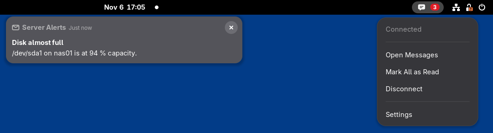
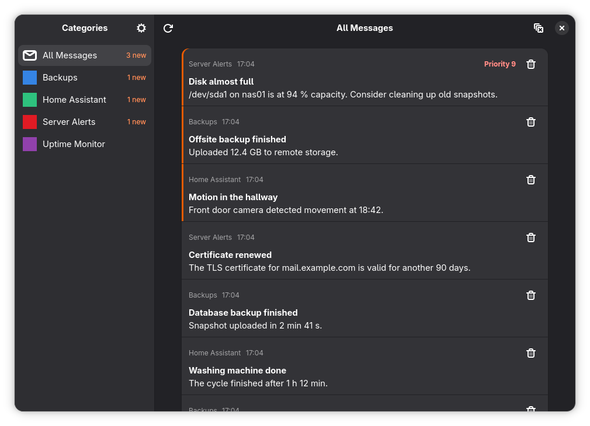
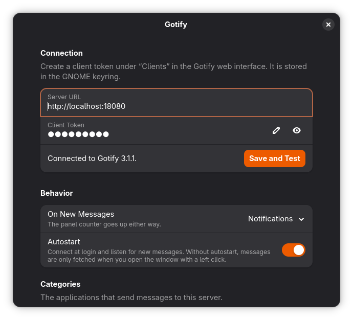

# Gotify for GNOME Shell

Read your [Gotify](https://gotify.net) messages right from the GNOME panel: a live unread counter,
optional desktop notifications, and a full messages window sorted by category.



> This is an unofficial extension. It is not affiliated with the Gotify project.

## Features

- **Live updates:** messages arrive instantly over a WebSocket, and anything missed during an interruption is fetched on reconnect
- **Counter or notifications:** the unread counter always runs; desktop notifications are optional
- **Messages window:** browse by category, see what's new, and delete single messages or whole categories
- **Autostart or on demand:** stay connected from login, or only fetch messages when you open the window
- **Secure token storage:** your client token is kept in the GNOME keyring, not in dconf

## Screenshots

### Messages window

Left-click the panel icon to open it. New messages are highlighted, and each category shows how many are new.



### Settings

Right-click the panel icon and choose **Settings**.



Screenshots use sample data.

## Requirements

- GNOME Shell 50
- A Gotify server
- A Gotify client token

## Installation

```sh
git clone https://github.com/Makario1337/gnome-shell-extension-gotify.git
cd gnome-shell-extension-gotify
make install
```

Log out and back in once so that GNOME Shell finds the extension, then enable it:

```sh
gnome-extensions enable gotify@makario1337.github.io
```

To remove it again, run `make uninstall`.

## Setup

1. In the Gotify web interface, go to **Clients** and create a client. An app token won't work, because it can't read messages.
2. Right-click the panel icon and choose **Settings**.
3. Enter your server URL and client token, then choose **Save and Test**.

## Usage

| Action | Result |
| --- | --- |
| Left-click the panel icon | Open the messages window and fetch messages |
| Right-click the panel icon | Show status, connect or disconnect, mark all as read, open settings |
| Click a notification | Open the messages window |

### Good to know

- On the first connection, everything already on the server counts as read, so the counter starts at 0.
- Opening the window marks everything as read. Messages that arrive while it is unfocused stay highlighted as new.
- If more than three messages arrive at once, one summary notification replaces the individual ones.
- Deleting in the window permanently removes messages from the server, for all clients.

## Development

| File | Purpose |
| --- | --- |
| `extension.js`, `indicator.js`, `notifier.js` | Run in the shell: panel icon, menu, notifications |
| `lib/service.js` | Background connection and unread tracking |
| `lib/client.js`, `lib/secret.js` | Gotify API and keyring access, used by all processes |
| `window/main.js` | Messages window, a separate GTK4 process because GTK can't be loaded into the shell |
| `prefs.js` | Settings window |

The shell and the messages window share the read position through GSettings (`last-read-id`).

`make pack` builds the extension bundle, and `make clean` removes build output.
